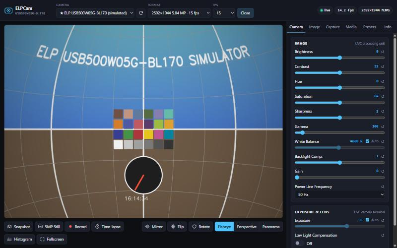
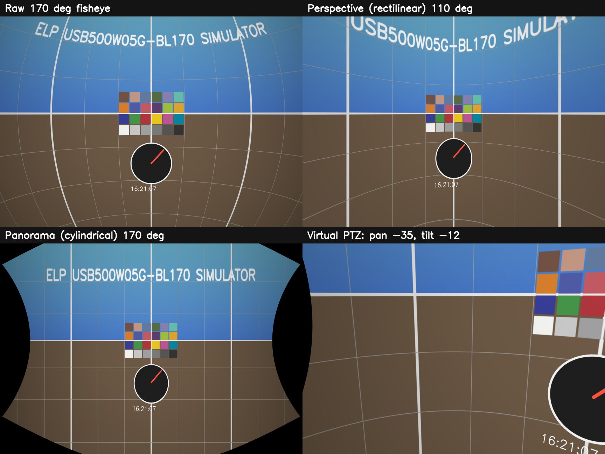

# ELPCam — Python engine + browser GUI for the ELP-USB500W05G-BL170

Full control of the **ELP-USB500W05G-BL170** 5-megapixel USB camera with a 170° fisheye lens. You get a Python engine
and a browser interface. It does what ELP's own Windows tool (AMCap) does: format, resolution, frame rate and every
UVC image/exposure control. It adds capture, fisheye dewarping, recording, time-lapse, presets and an HTTP API. It
runs on Windows (DirectShow), Linux (V4L2) and macOS (AVFoundation, basic controls).



## Features

| Area | What you can do |
|---|---|
| **Device** | Auto-detects the ELP camera, lists every camera, hot-switches devices, and reconnects automatically if the USB cable is pulled |
| **Format** | Every pixel format / resolution / frame rate the camera reports (MJPEG and YUY2, up to 2592×1944 @ 15 fps), read straight from the driver |
| **Image controls** | Brightness, contrast, hue, saturation, sharpness, gamma, white balance (auto/manual), backlight compensation, gain, power-line frequency (50/60 Hz anti-flicker) |
| **Exposure & lens** | Exposure (auto/manual, shown as shutter time), low-light compensation, plus focus/zoom/pan/tilt/iris when a camera has them, each with the driver's real range and default |
| **Driver dialog** | Opens the driver's own property sheet, the same dialog AMCap shows (Windows) |
| **Fisheye dewarp** | Raw fisheye, **perspective** (straight lines stay straight) or **panorama** (cylindrical) view, with a **virtual pan/tilt/roll/zoom**: drag the picture to look around, scroll to zoom |
| **Lens calibration** | Optional checkerboard calibration (OpenCV fisheye model) for exact dewarping, stored per resolution |
| **Orientation** | Mirror, flip, rotate 90/180/270, digital zoom with panning |
| **Overlays** | Timestamp, thirds grid, crosshair and a custom label. You choose whether they're burned into photos and videos |
| **Stills** | JPEG / PNG / BMP / TIFF snapshots, plus a **full-resolution 5 MP still** from any mode (it switches to 2592×1944, lets exposure settle, captures, and switches back). Optional raw (unprocessed) frames |
| **Video** | MP4 (H.264, plays in the browser; MPEG-4), AVI (Motion-JPEG, XviD). Frames are paced to a constant rate so playback runs in real time |
| **Time-lapse** | Any interval. Saves numbered JPEGs and builds an MP4 as it goes |
| **Presets** | Save and apply every control (with auto flags), the processing settings and the format |
| **Media browser** | Thumbnails, in-browser viewer, download, delete |
| **Tools** | Live RGB/luma histogram, fullscreen, keyboard shortcuts, live FPS and processing-time readout |
| **API / CLI** | Every GUI action is a REST call (`/docs` has interactive OpenAPI docs). MJPEG stream at `/stream.mjpg`. CLI for scripting |
| **Simulator** | `--simulate` adds a software ELP camera (synthetic 170° fisheye scene, real ELP mode table) so you can try everything without hardware |

## Quick start

Requires **Python 3.10+**.

**Windows:** double-click `run.bat`, or:

```bat
python -m venv .venv
.venv\Scripts\pip install -r requirements.txt
.venv\Scripts\python -m elpcam
```

**Linux / Raspberry Pi / macOS:**

```bash
./run.sh            # creates .venv, installs requirements, starts the GUI
```

The GUI opens at <http://127.0.0.1:8750/>. To use it from another machine on your network:
`python -m elpcam serve --host 0.0.0.0` (there is no authentication, so only do this on a trusted network).

No camera at hand? Run `python -m elpcam --simulate`.

### Windows camera privacy (important)

Windows 10/11 can block camera access per app. If ELPCam says *"Windows blocks camera access…"*, open
**Settings → Privacy & security → Camera** and turn on:

* **Camera access** and **Let apps access your camera**, and
* **Let desktop apps access your camera** (python.org Python), **or** the **Python 3.x** entry if you installed
  Python from the **Microsoft Store**. Store Python is a packaged app with its own switch. If you once dismissed its
  permission prompt, it is set to *Off*.

ELPCam reads these settings and tells you exactly which switch is blocking it.

## Command line

```text
python -m elpcam [--data-dir DIR] [--device N] [--simulate] <command>

  serve      start the browser GUI (default)   --host  --port  --mode MJPG:1920x1080  --no-browser
  list       list cameras and every video mode / frame rate
  controls   list every control with range, default, current value and auto state
  set        set a control:  python -m elpcam set exposure -7 --manual
                             python -m elpcam set white_balance --auto
  snapshot   grab one still: python -m elpcam snapshot out.jpg --mode MJPG:2592x1944
  info       print the ELP-USB500W05G-BL170 spec sheet and documentation links
```

## Using the engine from Python

```python
from elpcam.engine import CameraEngine

eng = CameraEngine("elpcam-data")              # captures/presets/settings live here
eng.open(mode_key="MJPG:1920x1080")             # picks the ELP camera automatically
eng.set_control("exposure", value=-7, auto=False)
eng.set_control("white_balance", auto=True)
eng.update_processing({"dewarp": "perspective", "out_fov": 110, "yaw": 20})
print(eng.snapshot(full_res=True))              # {'file': 'IMG_....jpg', 'width': 2592, 'height': 1944, ...}
eng.start_recording("mp4-h264"); ...; eng.stop_recording()
frame = eng.capture_frame()                     # latest processed frame as a numpy BGR array
eng.shutdown()
```

## HTTP API (selection)

| Method & path | Purpose |
|---|---|
| `GET /stream.mjpg` | live MJPEG preview (embed with ``) |
| `GET /api/frame.jpg?full=1` | single frame (preview size, or full size with `full=1`, unprocessed with `raw=1`) |
| `GET /api/status` | state, measured fps, frame size, recording/time-lapse status, events |
| `GET /api/devices` · `POST /api/open` · `POST /api/close` | device selection |
| `GET /api/modes` · `POST /api/mode` | `{"mode": "MJPG:2592x1944", "fps": 15}` |
| `GET /api/controls` · `POST /api/controls/{id}` · `POST /api/controls-reset` | `{"value": -7, "auto": false}` |
| `GET/POST /api/processing` | dewarp, orientation, zoom, overlays, preview size/quality |
| `POST /api/snapshot` | `{"format": "jpg", "full_res": true, "raw": false}` |
| `POST /api/record/start` · `/stop` | `{"container": "auto" \| "mp4-h264" \| "mp4" \| "avi" \| "avi-xvid"}` |
| `POST /api/timelapse/start` · `/stop` | `{"interval": 5, "video_fps": 30, "make_video": true}` |
| `/api/presets…`, `/api/media…`, `/api/calibration…` | presets, captured files, lens calibration |

Full interactive reference: <http://127.0.0.1:8750/docs>.

## Fisheye dewarping



Without calibration the lens is modelled as an ideal equidistant fisheye. Adjust **Lens field of view** until
straight edges look straight. For exact results, print a checkerboard (default 9×6 inner corners). Then in
**Capture → Fisheye calibration**, capture 10–20 views covering the whole frame and press **Compute**. Calibration
is saved per resolution in `elpcam-data/calibration.json`.

## Where things are saved

`elpcam-data/` (or `--data-dir`): `captures/` (photos, videos, time-lapse folders), `presets/`,
`settings.json` (last device/format/processing, restored on start) and `calibration.json`.

## Project layout

```text
elpcam/
  engine.py          capture thread, modes, stills, recording, time-lapse, presets, media
  processing.py      fisheye dewarp (perspective / panorama / virtual PTZ), orientation, zoom, overlays
  calibration.py     checkerboard fisheye calibration (cv2.fisheye)
  controls/
    dshow.py         Windows DirectShow via comtypes: IAMVideoProcAmp, IAMCameraControl,
                     IAMStreamConfig, IAMVideoControl, driver property pages
    v4l2.py          Linux V4L2 via v4l2-ctl
    opencv_props.py  portable fallback (CAP_PROP_*)
  simulator.py       software ELP camera for demos and CI
  diagnostics.py     explains Windows camera-privacy blocks
  server.py          FastAPI REST API + MJPEG stream
  web/               browser GUI (plain HTML/CSS/JS, no CDN, works offline)
docs/CAMERA.md       camera research notes, official software and documentation links
tests/               unit + end-to-end API tests (run against the simulator)
```

## Camera documentation & official software

See [docs/CAMERA.md](docs/CAMERA.md) for the spec sheet, official ELP/SVPRO downloads (AMCap, 5MP USB camera
testing software, Windows/Linux/Android SDKs) and how each control maps to UVC, DirectShow and V4L2.

## Development

```bash
pip install -r requirements.txt pytest
python -m pytest -q
```

## License

MIT. See [LICENSE](LICENSE). ELP is a trademark of Shenzhen Ailipu Technology Co., Ltd. This project is an
independent open-source tool and is not affiliated with or endorsed by ELP/Ailipu.
